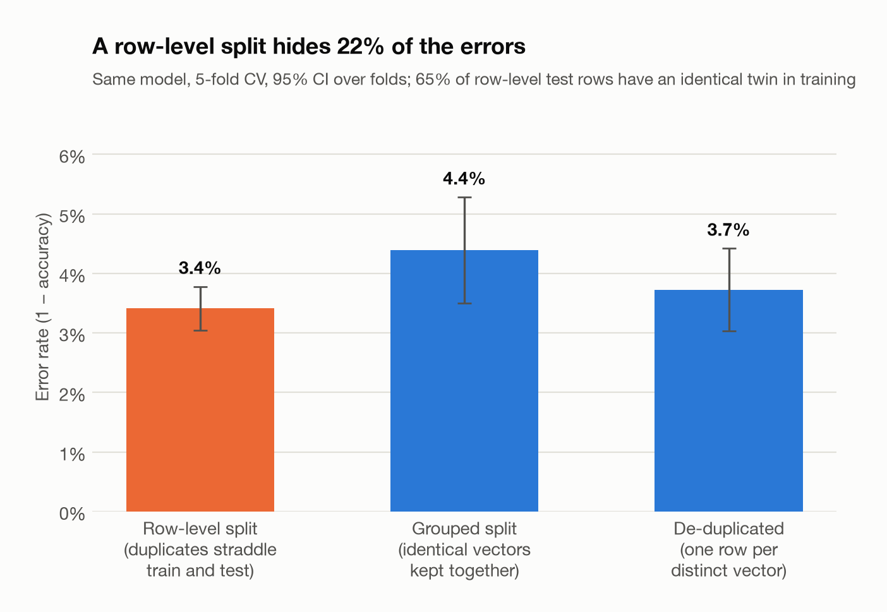
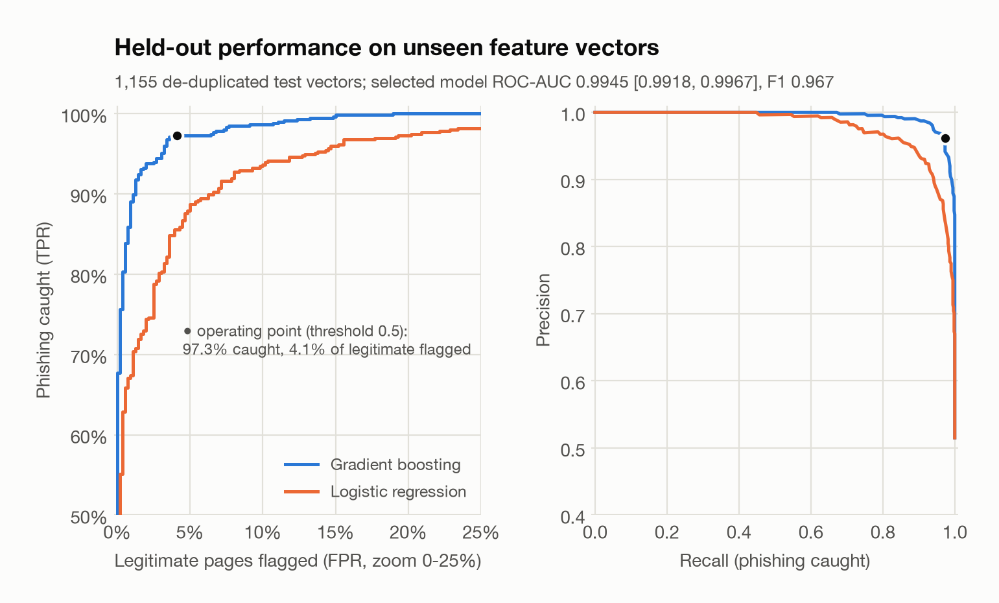
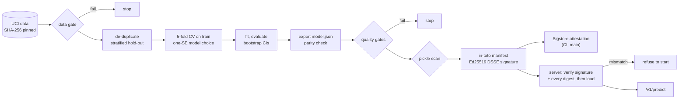

# MLSeal: a secure MLOps pipeline for a phishing-website classifier

[](https://github.com/hugo-kte/secure-mlops-pipeline/actions/workflows/ci.yml)


How do you ship a machine-learning model so that every step can be checked? MLSeal takes a
small but real security model (phishing-website detection on the UCI dataset) through a
pipeline where **every input is pinned and verified, every gate runs in CI, the model file
cannot execute code, the release is signed with its provenance, and the server refuses to
start on anything it cannot verify**. The model is the vehicle; the delivery path is the
point. Each control is tested, and the [threat model](docs/THREAT_MODEL.md) maps it to the
OWASP Machine Learning Security Top 10, MITRE ATLAS, SLSA and NIST SSDF / AI RMF.

## Results

Gradient boosting (300 trees, depth 4) on the **de-duplicated hold-out set: 1,155 feature
vectors never seen in training**. 95% confidence intervals from 2,000 bootstrap resamples
([`reports/metrics.json`](reports/metrics.json),
[model card](reports/MODEL_CARD.md)).

| Metric | Value | 95% CI |
|---|---:|---:|
| ROC-AUC | **0.9945** | [0.9918, 0.9967] |
| F1 | **0.967** | [0.957, 0.977] |
| Accuracy | 96.6% | [95.6%, 97.6%] |
| Recall (phishing caught) | 97.3% | [96.0%, 98.6%] |
| Precision | 96.2% | [94.6%, 97.6%] |

At the 0.5 threshold: 579 of 595 phishing pages caught, 23 of 560 legitimate pages flagged. A
logistic-regression baseline reaches ROC-AUC 0.976 and F1 0.921 on the same test set.

**The dataset hides a trap.** Of its 11,055 rows only 5,785 feature vectors are distinct:
47.7% of rows repeat an earlier row, and 64 vectors carry both labels. With the row-level
split most papers use, 65% of test rows have an identical twin in training, and the error
rate looks 22% lower than it is (3.4% vs 4.4% when identical vectors are kept on one side of
the split). MLSeal de-duplicates before splitting and a data gate fails on any train/test
overlap.





## What the pipeline enforces

Every row is a CI step that fails the build; each has negative tests that show it firing.

| Gate | Checks | Threat it addresses |
|---|---|---|
| Data gate | SHA-256 pin of the dataset, schema and allowed values, row count, label balance, contradictory duplicates, per-feature drift (PSI) vs a reviewed profile, zero train/test overlap | Data poisoning, swapped or truncated data, evaluation leakage |
| Quality gates | Metric floors (ROC-AUC ≥ 0.98, F1 ≥ 0.93, recall ≥ 0.92), maximum regression vs the approved baseline, JSON-runtime parity with scikit-learn (≤ 1e-9), exact reproduction of the committed report | Silent model degradation, stale or hand-edited reports |
| Model file scan | No pickle in the release bundle; static opcode scan of any pickle (non-allowlisted imports, unresolvable names, unparseable streams refused) | Code execution through malicious model files |
| Sign and verify | Ed25519 signature over an in-toto manifest of every bundle file; tampering test (a modified bundle must be refused) | Model tampering between build and deployment |
| Attestation (`main`) | Sigstore-signed SLSA build provenance for the bundle (GitHub artifact attestations, no long-lived key) | Unknown provenance, stolen signing keys |
| Supply chain | `uv.lock` and the image requirements in sync, pip-audit on every locked package, CycloneDX SBOMs (dependencies and image), zizmor on the workflows | Vulnerable or compromised dependencies, unsafe CI configuration |
| Secrets | gitleaks over the full git history | Leaked keys and tokens |
| Container | Build from a digest-pinned base with hash-checked wheels, run read-only, non-root, all capabilities dropped; readiness, prediction, Docker health check; a tampered bundle must stop the container | Runtime compromise, unverified models in production |
| Lint and tests | ruff with the Bandit security rules, 240+ tests on Python 3.11 to 3.13, including policy tests on the workflows and the Dockerfile | Regressions in any of the above |

## How it works



* **Data gate** ([`validation.py`](src/mlseal/validation.py)). One named check per property,
  with observed value and limit, written to `data_validation.json`. Flipping the label of a
  single row breaks the hash pin; flipping one copy of 100 duplicated vectors passes the
  balance check but trips the contradictory-duplicates check; shifting one feature trips the
  drift check (all tested).
* **Training** ([`pipeline.py`](src/mlseal/pipeline.py)). Seeded, deterministic (the same
  run is byte-identical whatever the number of worker processes), dependencies installed
  from a hash-locked `uv.lock` with a 14-day cooldown on new releases. Candidates are
  compared by cross-validation on the training split only; the simplest one within one
  standard error of the best is shipped (here depth 4 instead of depth 5: CV ROC-AUC 0.9942
  vs 0.9943).
* **Safe model format** ([`modelfile.py`](src/mlseal/modelfile.py)). The model is exported to
  plain JSON (246 KB): numbers and short strings under a closed schema, trees that provably
  terminate, NaN and duplicate keys rejected. A numpy runtime evaluates it and must match
  scikit-learn on all 5,772 distinct vectors (observed max |Δp| 3.3e-16). The serving path
  never imports pickle, joblib or scikit-learn (an AST test enforces it), and the container
  does not even contain them.
* **Pickle scanner** ([`scanner.py`](src/mlseal/scanner.py)). For the third-party model files
  a team will eventually be handed: walks the opcode stream with `pickletools`, replays
  enough of the stack to resolve every imported name (memoized strings included) and refuses
  anything not allowlisted, unresolvable or unparseable. Zip containers (PyTorch layout) and
  compressed pickles are unpacked under size limits. It never unpickles.
* **Provenance and signing** ([`provenance.py`](src/mlseal/provenance.py),
  [`signing.py`](src/mlseal/signing.py)). The manifest is an in-toto v1 Statement: the
  SHA-256 of each bundle file, plus the digests of the dataset, lock file and config (checked
  again at signing time), the commit, builder, evaluation and gate outcomes. It is signed
  with Ed25519 in a DSSE envelope. `mlseal sign` refuses a bundle that failed a gate,
  contains a pickle or does not load.
* **Hardened serving** ([`serving/`](src/mlseal/serving)). At startup the server verifies the
  signature and every digest, then parses the exact bytes it verified; any failure stops the
  process. Requests must match the 30-feature contract exactly (strict integers in each
  feature's allowed set; unknown fields, `true`, `1.0` and `"1"` are rejected), bodies are
  capped at 32 KiB even when chunked, batches at 32, and clients are rate-limited. Errors
  never echo the input, logs are JSON without payloads or client addresses, and the
  interactive docs are disabled.

## Evaluation protocol

1. Parse the pinned file strictly, run the data gate.
2. Collapse identical feature vectors (majority label; 13 ties with no majority are dropped):
   5,772 vectors, 2,972 phishing and 2,800 legitimate.
3. Stratified 80/20 split with a fixed seed: 4,617 training and 1,155 test vectors; the gate
   confirms no vector is on both sides.
4. Model selection by 5-fold stratified CV on the training split only (ROC-AUC, mean and
   t-interval over folds).
5. Fit on the training split and evaluate once on the test split. The shipped model is the
   evaluated model, not a refit on all data, so the metrics describe the exact artifact
   that is signed.
6. 95% CIs by percentile bootstrap over test vectors (they are distinct, so resampling them
   independently is sound).
7. Duplicate analysis: the same model under row-level, grouped and de-duplicated 5-fold CV
   (figure above).

**Reproducibility.** A retrain in a Linux container reproduced all 1,599 floating-point
values of the macOS `metrics.json` exactly, and in CI the `reproducible` gate fails if a
fresh retrain drifts from the committed report by more than 1e-6. On Linux the build was
byte-identical across machines: a local container and the GitHub runner produced the same
`model.json` (`sha256:b0d29188…`). Across operating systems it is not: tied splits resolve
differently at the last floating-point bit, yet predictions agree to 1e-15 on 200,000 random
valid inputs. The gate therefore compares metrics, not file hashes.

## Quickstart

Requires [uv](https://docs.astral.sh/uv/) (and Docker for the container targets).

```bash
git clone https://github.com/hugo-kte/secure-mlops-pipeline.git && cd secure-mlops-pipeline
make install      # .venv from uv.lock, every package hash-verified
make pipeline     # train -> gate -> scan -> sign (creates runtime/keys/ on first run) -> verify
make serve        # verified bundle on http://127.0.0.1:8080
make docker && make docker-run   # same, in the hardened container
make test         # 240+ tests (trains small models on the real data)
```

```bash
curl -s -X POST http://127.0.0.1:8080/v1/predict \
  -H 'content-type: application/json' --data @examples/request.json
# {"model":{"name":"phishing-gbm","version":"1.0.0","sha256":"…","signed_by":"…"},
#  "predictions":[{"phishing_probability":1.0,"label":"phishing"},
#                 {"phishing_probability":0.019,"label":"legitimate"}]}
```

```text
mlseal validate          data gate only
mlseal train             data gate, de-duplicated split, CV selection, evaluation, export
mlseal gate              quality gates vs reports/metrics.json [--expect-reproducible]
mlseal scan PATH...      pickle scanner [--forbid-pickle]
mlseal keygen | sign | verify
mlseal promote           make the last run the new baseline (a reviewed commit)
mlseal serve             verify, then serve
mlseal data-provenance   re-download the UCI archive and compare with the pinned digest
```

Verify a bundle built by CI (artifact `release-bundle` of a run on `main`):

```bash
gh run download <run-id> --repo hugo-kte/secure-mlops-pipeline -n release-bundle -D release
gh attestation verify release/bundle/model.json --repo hugo-kte/secure-mlops-pipeline
mlseal verify --bundle release/bundle --public-key release/signing.pub
```

The first check proves the file was built by this repository's workflow on `main` (SLSA
provenance, Sigstore, transparency log); the second checks the signed manifest and every
digest. The public key shipped with a CI bundle is ephemeral, so it only proves integrity
within that run; long-lived trust comes from the attestation.

API: `GET /healthz` (liveness), `GET /readyz` (bundle verified and loaded), `GET /v1/model`
(verified digest, signer, commit, evaluation), `POST /v1/predict`. Server settings come from
`MLSEAL_*` environment variables ([`settings.py`](src/mlseal/serving/settings.py)).

## Project layout

```text
src/mlseal/
├── schema.py        the 30-feature contract shared by the data gate, model file and API
├── data.py          strict ARFF reader, hashing, de-duplication, upstream digest check
├── validation.py    data gate (checks, PSI drift, train/test overlap)
├── training.py      candidates, CV selection (one-SE rule), duplicate protocols
├── metrics.py       metrics, vectorised bootstrap CIs, curves
├── export.py        scikit-learn -> JSON export with a parity self-check
├── modelfile.py     safe JSON model format: strict loader and numpy runtime
├── scanner.py       static pickle scanner
├── gates.py         floors, regression vs baseline, reproducibility
├── provenance.py    in-toto statement (materials, builder, outcomes)
├── signing.py       Ed25519 keys, DSSE envelopes, bundle verification
├── modelcard.py, plots.py, pipeline.py, cli.py
└── serving/         FastAPI app, size and rate limits, JSON logs, settings
configs/             pipeline.yaml (seed, policy, candidates, gates), reference profile
data/                the dataset (CC BY 4.0) and its data card
docs/THREAT_MODEL.md assets, threats, controls, framework mappings, key management
reports/             promoted baseline: metrics, model card, data and gate reports, figures
tests/               240+ tests, including negative security and policy tests
Dockerfile, .github/workflows/ci.yml, uv.lock, requirements/serve.txt (hashed, for the image)
```

## Limitations

* **Old data, pre-computed features.** The dataset dates from 2012-2015 and ships the
  authors' ternary features, not URLs or HTML. Performance on today's phishing is unknown,
  and production use would need a feature extractor that reproduces the authors' rules.
* **The test distribution is a choice.** De-duplication weights every distinct vector
  equally, which is the honest test of generalisation but not the deployment distribution.
* **Data checks catch blunt manipulation.** A careful attacker with write access to the
  source can poison within statistical bounds (clean-label, backdoors); the hash pin only
  proves the data is the reviewed data.
* **Local signing key.** The Ed25519 key has no transparency log or revocation; CI's
  long-lived trust comes from Sigstore attestations instead. The image itself is built and
  tested but not signed or pushed.
* **Not evaluated:** adversarial evasion, which matters because phishers control most of
  these features, and extraction resistance beyond friction (rounding, rate limits).

## Data, license and citation

Code: [MIT](LICENSE). Data: UCI Machine Learning Repository, "Phishing Websites" by Rami
Mohammad and Lee McCluskey, [CC BY 4.0](https://creativecommons.org/licenses/by/4.0/legalcode),
committed unmodified (renamed only) with its SHA-256 pinned; see [`data/README.md`](data/README.md).

> Mohammad, R. & McCluskey, L. (2012). Phishing Websites [Dataset]. UCI Machine Learning
> Repository. https://doi.org/10.24432/C51W2X
