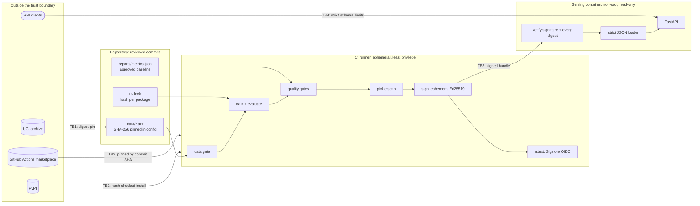

# Threat model

This document covers the path from a public dataset to a prediction served over HTTP: data
intake, training and evaluation in CI, the release bundle, and the serving container. For
every threat it lists what is implemented (with the code and the test that proves it), what
is deliberately out of scope, and how it maps to the OWASP Machine Learning Security Top 10
(2023), MITRE ATLAS, SLSA v1.0, NIST SSDF (SP 800-218) and the NIST AI RMF 1.0.

The model (a phishing-website classifier) is public and low-stakes. The point is the delivery
path, which is the same for a model that matters.

## System and trust boundaries



* **TB1, data intake.** The dataset is third-party content. It enters the repository once,
  through a reviewed commit, and its SHA-256 is pinned; `mlseal data-provenance` re-checks it
  against the publisher's archive.
* **TB2, build inputs.** Python packages and CI actions are third-party code that runs with
  the pipeline's privileges. Both are pinned to immutable identifiers.
* **TB3, artifact handoff.** Anything between the build and the server (artifact store,
  registry, volume) is assumed hostile: the server trusts only a signature it can verify.
* **TB4, inference.** Every request is untrusted input from a possibly adversarial client.

## Assets

| ID | Asset | Why it matters |
|---|---|---|
| A1 | Training data integrity | Labels and features decide what the model learns. |
| A2 | Model artifact integrity | The parameters *are* the decisions served. |
| A3 | Provenance record | Answers "which data, code and dependencies produced this model?" |
| A4 | CI environment and credentials | `GITHUB_TOKEN`, the OIDC identity used for attestations. |
| A5 | Signing key | Whoever holds it can make the server load anything. |
| A6 | Service availability and correctness | Wrong or missing verdicts. |
| A7 | Model confidentiality | Public here, but the extraction controls are the pattern. |
| A8 | Request data | URLs and page features submitted by users. |

## Adversaries

* **Upstream compromise:** a poisoned dataset, a malicious package release, a hijacked
  GitHub Action tag.
* **Artifact tamperer:** can modify files between build and deployment (bucket, registry,
  shared volume) but holds no signing key.
* **Malicious contribution:** a pull request that changes data, code or workflows.
* **Abusive client:** malformed or oversized requests, flooding, scraping for extraction.

Out of scope: a maintainer who can both merge and sign, a compromised GitHub platform or
runner image, and physical or hypervisor access.

## Threats and controls

### T1 Data poisoning

*OWASP ML02 Data Poisoning · ATLAS AML.T0020 Poison Training Data, AML.T0019 Publish Poisoned
Datasets, AML.T0010.002 Supply Chain Compromise: Data · SSDF PS.1 · AI RMF MAP 4.1*

Implemented ([`validation.py`](../src/mlseal/validation.py), tests in
[`test_validation.py`](../tests/test_validation.py)), all enforced before any training and
again in CI:

* SHA-256 pin of the data file: a single changed byte stops the pipeline.
* `mlseal data-provenance`: the pinned file still equals the publisher's archive member.
* Schema (attribute names, order, domains) and allowed values per feature.
* Row count bounds (truncation), label balance bounds (mass label flipping).
* Contradictory duplicates: the share of feature vectors seen with both labels. Flipping the
  label of one copy of 100 duplicated vectors passes the balance check but fails this one
  (tested).
* Distribution drift: population stability index of every feature against a reviewed
  reference profile ([`configs/reference_profile.json`](../configs/reference_profile.json)).

Residual risk: poisoning by the publisher before the pin (the 2012 dataset is trusted as
published), and low-rate, clean-label or backdoor poisoning that stays inside statistical
bounds. These checks catch blunt manipulation, not a careful adversary with write access to
the source.

### T2 Misleading evaluation

*AI RMF MEASURE 2.5 (valid and reliable), MEASURE 2.1 (test sets and metrics documented)*

A release decision based on an inflated metric is an integrity failure even without an
attacker: 47.7% of this dataset's rows repeat an earlier row, and a row-level split puts 65%
of test rows' exact twins in the training set.

Implemented: de-duplication before splitting, a gate that fails on any train/test overlap,
model selection by cross-validation on the training split only, confidence intervals, and a
CI gate that retrains from scratch and must reproduce the committed report
([`pipeline.py`](../src/mlseal/pipeline.py), [`gates.py`](../src/mlseal/gates.py)).

### T3 Model tampering

*OWASP ML10 Model Poisoning, ML06 AI Supply Chain Attacks · ATLAS AML.T0010.003 Supply Chain
Compromise: Model, AML.T0018 Backdoor ML Model · SLSA provenance · SSDF PS.2, PS.3*

Implemented ([`provenance.py`](../src/mlseal/provenance.py),
[`signing.py`](../src/mlseal/signing.py)):

* The release manifest is an in-toto v1 Statement: subjects are every bundle file with its
  SHA-256; the predicate records the dataset, lock file and config digests (re-checked at
  signing time), the source commit, the builder, the evaluation and the gate outcomes.
* It is signed with Ed25519 in a DSSE envelope (the payload type is bound into the
  signature). `mlseal sign` refuses a bundle whose data gate or quality gates failed, that
  contains any pickle, or whose model does not load.
* The server verifies before it parses: trusted signature, then every digest, reading each
  file once into memory so the verified bytes are the parsed bytes (no TOCTOU). Symlinked
  subjects, path-like subject names, duplicate JSON keys and a statement that does not cover
  `model.json` are refused, and so is a validly signed statement whose recorded gate outcomes
  are not all "passed" (the server does not assume every signer used `mlseal sign`). Any
  failure stops startup; the container exits.
* On `main`, CI also attests the bundle with GitHub artifact attestations (Sigstore keyless,
  recorded in the public transparency log).

Tested in [`test_signing.py`](../tests/test_signing.py) (every bundle file modified, wrong
key, unsigned, symlink, re-signed but invalid statements),
[`test_api.py`](../tests/test_api.py) (the app refuses to start) and in CI's `docker` job (a
tampered bundle makes the real container exit non-zero).

Residual risk: theft of the signing key or compromise of the signing environment. The local
Ed25519 key has no transparency log or revocation; rotation means re-signing and
redistributing the public key.

### T4 Malicious serialized model (code execution on load)

*OWASP ML06 · ATLAS AML.T0011.000 User Execution: Unsafe ML Artifacts, AML.T0010.003 · CWE-502*

Unpickling runs whatever callables the file names: a `.pkl`, `.joblib` or PyTorch checkpoint
is code.

Implemented:

* The model is plain JSON ([`modelfile.py`](../src/mlseal/modelfile.py)): numbers and short
  strings, a closed schema (exact keys, size limits, finite values, NaN/Infinity and
  duplicate keys rejected) and tree structures that provably terminate (every child index is
  greater than its parent's, every node has exactly one parent). A numpy runtime evaluates
  it; parity with scikit-learn is a release gate (max |Δp| ≤ 1e-9, observed ~3e-16).
* The serving path never imports a deserialiser: an AST test forbids pickle, joblib, dill,
  cloudpickle, skops, shelve, marshal, scikit-learn and torch in those modules, and a runtime
  test checks the training stack is never loaded. The container does not even ship them.
* A static pickle scanner ([`scanner.py`](../src/mlseal/scanner.py)) for third-party files:
  walks the opcode stream with `pickletools`, resolves every imported global (including names
  assembled from memoized strings) and fails closed on anything non-allowlisted,
  unresolvable or unparseable. It handles zip containers (PyTorch layout) and compressed
  pickles, with decompression-bomb limits. A release bundle may contain no pickle at all.

Residual risk: the scanner is a gate for files you choose to inspect, not a sandbox. Formats
it cannot fully parse (joblib files with raw array blocks) are refused rather than analysed.
Bugs in `json` or numpy themselves are out of scope.

### T5 Dependency compromise

*OWASP ML06 · ATLAS AML.T0010.001 Supply Chain Compromise: ML Software · SLSA dependencies ·
SSDF PW.4, PS.3, RV.1 · AI RMF MANAGE 3.1*

Implemented:

* `uv.lock` pins every package with its hashes; CI installs with `uv sync --locked`. A job
  fails if the lock or `requirements/serve.txt` drifts from `pyproject.toml`.
* The image installs `requirements/serve.txt` with `--require-hashes --only-binary=:all:`:
  no unpinned package, no sdist, no build script executed.
* A 14-day dependency cooldown (`exclude-newer` in `pyproject.toml`) keeps freshly published
  (possibly hijacked) releases out; the one exception (the portfolio-wide ruff pin) is
  documented in place.
* `pip-audit` checks every locked package against the PyPI and OSV advisory databases on
  every CI run.
* CycloneDX SBOMs: the serving dependencies (`cyclonedx-py`) and the built image (Syft).
* Minimal runtime: 24 packages in the image, no scikit-learn, scipy, pandas or joblib.

Residual risk: a malicious release older than the cooldown and unknown to advisories; trust
in the index at lock time. There is no automated update bot; pins move by a reviewed
`make lock`.

### T6 CI/CD compromise

*SLSA Build track · SSDF PO.3, PO.5, PS.1 · ATLAS AML.T0010.001*

Implemented in [`.github/workflows/ci.yml`](../.github/workflows/ci.yml), with the rules
themselves enforced by [`test_policies.py`](../tests/test_policies.py):

* Every action pinned to a full commit SHA; container images pinned by digest.
* `permissions: {}` at workflow level, `contents: read` per job; only the `attest` job may
  request an OIDC token (`id-token: write`), and it runs only on pushes to `main`.
* `persist-credentials: false` on every checkout; no `pull_request_target`; no caches (no
  cache poisoning across runs); no `github.event` expressions inside shell scripts.
* zizmor (GitHub Actions static analysis) and gitleaks (full history) on every run.
* The signing key is generated inside the job and deleted before the artifact upload; the
  long-lived trust anchor in CI is Sigstore keyless signing, so there is no secret to steal.

Residual risk: compromised GitHub-hosted runners, or a pinned action that downloads further
tooling at run time (the Syft binary fetched by `anchore/sbom-action`). Branch protection,
required reviews and environment protection are repository settings, not code, and must be
configured separately.

### T7 Secret leakage

*SSDF PS.1 · CWE-798*

Implemented: no private key ever lives in the repository (`*.key`, `*.pem` and `runtime/`
are git-ignored); gitleaks runs in pre-commit and on the full history in CI; a test fails if
any PEM private key appears in the tree. `mlseal keygen` writes the key with `O_EXCL` and mode
0600 and never overwrites one; the optional passphrase comes from `MLSEAL_KEY_PASSPHRASE`,
never from a command-line argument (shell history, `ps`).

### T8 Malformed input and denial of service

*OWASP ML01 Input Manipulation (input validation part) · ATLAS AML.T0029 Denial of ML Service,
AML.T0034 Cost Harvesting · SSDF PW.9*

Implemented ([`serving/`](../src/mlseal/serving)), tested in
[`test_api.py`](../tests/test_api.py):

* Exactly the 30 contract fields, unknown fields forbidden, each value a strict integer in
  its allowed set. A test found that pydantic's `Literal[-1, 0, 1]` accepts JSON `true` and
  `1.0` even in strict mode (both compare equal to 1); the schema now uses `StrictInt` plus an
  allowlist.
* JSON only (415 otherwise); body capped at 32 KiB before parsing, whether Content-Length is
  honest, missing (chunked) or invalid; at most 32 instances per request.
* Per-client token-bucket rate limit (bounded memory), uvicorn concurrency limit, short
  keep-alive, capped header size.
* Validation errors say where and why, never echo the input; interactive docs and the
  OpenAPI schema are disabled; no debug mode; no server header; `nosniff`, `no-store` and a
  deny-all CSP on every response.

Residual risk: the rate limiter is per process. Volumetric attacks belong to the gateway.

### T9 Model extraction, inversion and membership inference

*OWASP ML05 Model Theft, ML03 Model Inversion, ML04 Membership Inference · ATLAS AML.T0024
Exfiltration via ML Inference API (.000, .001, .002), AML.T0040 ML Model Inference API Access*

Implemented, as friction rather than prevention: probabilities rounded to three decimals,
rate and batch limits, and access logs that count instances and flagged predictions per
request (without payloads) so scraping is visible.

Residual risk: with 30 ternary inputs and label access, a patient client can still
approximate the model. Here model and data are public anyway; a confidential model would add
authentication, per-identity quotas and query-pattern monitoring.

### T10 Adversarial evasion

*OWASP ML01 · ATLAS AML.T0015 Evade ML Model, AML.T0043 Craft Adversarial Data*

Out of scope. Phishers control their own pages, so most features are attacker-controlled by
nature; robustness was not evaluated. Mitigations would be feature-level monitoring, regular
retraining on fresh data and ensembles with signals the attacker controls less (domain age,
reputation feeds).

### T11 Sensitive data in logs

*CWE-532*

Implemented: JSON logs with request id, path, status, latency and counts; no request body,
no query string, no client IP. A test sends a canary value and checks it never reaches the
emitted log lines.

### T12 Compromise of the running container

*SSDF PW.9 (secure defaults)*

Implemented ([`Dockerfile`](../Dockerfile)): slim base pinned by digest, multi-stage build,
hash-checked wheels only, no pip in the runtime virtualenv, non-root UID 10001, works with a
read-only root filesystem and all capabilities dropped (`--cap-drop ALL`,
`no-new-privileges`, pids and memory limits in `make docker-run` and CI), bundle and key
mounted read-only, an allowlist `.dockerignore` so keys and bundles can never enter a layer,
and a health check.

Residual risk: kernel and runtime vulnerabilities; base-image CVEs between digest bumps (the
image SBOM is produced, but no image vulnerability gate is enforced).

### T13 Unknown provenance of a running model

*SLSA provenance · SSDF PS.3*

Implemented: `/v1/model` and the startup log report the verified model digest, the signer's
key id, the source commit and the signing time; the Sigstore attestation can be checked
independently with `gh attestation verify`.

## Framework coverage

### OWASP Machine Learning Security Top 10 (2023)

| Risk | Status | Where |
|---|---|---|
| ML01 Input Manipulation | Input validation implemented; evasion out of scope | T8, T10 |
| ML02 Data Poisoning | Implemented (blunt poisoning) | T1 |
| ML03 Model Inversion | Friction only | T9 |
| ML04 Membership Inference | Friction only | T9 |
| ML05 Model Theft | Friction only | T9 |
| ML06 AI Supply Chain Attacks | Implemented | T3, T4, T5, T6 |
| ML07 Transfer Learning Attack | Not applicable: no pretrained model | |
| ML08 Model Skewing | Not applicable: no online learning; retraining needs a reviewed commit | T1 |
| ML09 Output Integrity Attack | Out of scope: TLS terminates at the ingress | |
| ML10 Model Poisoning | Implemented (tampering of the artifact) | T3 |

### MITRE ATLAS

| Technique | Control |
|---|---|
| AML.T0010 ML Supply Chain Compromise (.001 software, .002 data, .003 model) | T1, T3, T5, T6 |
| AML.T0011.000 User Execution: Unsafe ML Artifacts | T4 |
| AML.T0018 Backdoor ML Model | T3 (tampering); training-time backdoors are residual risk in T1 |
| AML.T0019 Publish Poisoned Datasets, AML.T0020 Poison Training Data | T1 |
| AML.T0024 Exfiltration via ML Inference API, AML.T0040 Inference API Access | T9 |
| AML.T0029 Denial of ML Service, AML.T0034 Cost Harvesting | T8 |
| AML.T0015 Evade ML Model, AML.T0043 Craft Adversarial Data | Out of scope (T10) |

Technique names follow ATLAS; recent releases rename "ML" to "AI" in several of them, the IDs
are unchanged.

### SLSA v1.0 (Build track)

* **Build L1** (provenance exists): every bundle carries a signed in-toto statement, local
  builds included.
* **Build L2** (hosted build, signed provenance): bundles built on `main` by GitHub-hosted
  runners get a Sigstore-signed SLSA provenance attestation (`actions/attest-build-provenance`).
* **Build L3** (hardened, non-forgeable provenance) is not claimed: it would need the build in
  an isolated reusable workflow.

### NIST SSDF (SP 800-218)

| Practice | Implementation |
|---|---|
| PO.3 Supporting toolchains | Pinned linters and scanners (ruff with Bandit rules, zizmor, gitleaks, pip-audit) |
| PO.5 Secure environments | Least-privilege CI, ephemeral runners, no persisted credentials |
| PS.1 Protect code | Secret scanning, policy tests on workflows, no keys in the tree |
| PS.2 Release integrity | Signed manifest verified at startup; Sigstore attestation |
| PS.3 Archive and provenance | In-toto statement, SBOMs, retained CI artifacts |
| PW.4 Reuse secure software | Locked, hash-checked, audited, minimal dependencies |
| PW.6 Build configuration | Wheels-only hash-checked image build; reproducibility gate |
| PW.7 Code analysis | ruff (incl. flake8-bandit), zizmor |
| PW.8 Testing | Unit, integration and negative security tests (signing, API, scanner) |
| PW.9 Secure defaults | Fail-closed startup, docs off, strict schema, read-only container |
| RV.1 Identify vulnerabilities | pip-audit on every run |

### NIST AI RMF 1.0

MAP 4.1 (third-party data and software risks: data card, upstream verification, dependency
controls), MEASURE 2.1 and 2.5 (documented, de-duplicated evaluation with confidence
intervals, [model card](../reports/MODEL_CARD.md)), MEASURE 2.7 (security evaluated: this
document and its tests), MANAGE 3.1 (third-party resources monitored: audit and provenance
checks). Governance functions are out of scope for a single repository.

## Key management

| Context | Private key | Public key |
|---|---|---|
| Local development | `runtime/keys/signing.key` (git-ignored, 0600, optional passphrase) | `runtime/keys/signing.pub` |
| CI | Generated in the job, deleted after signing; never uploaded | Uploaded with the bundle for the container test |
| CI, long-lived trust | None: Sigstore keyless signing with the workflow's OIDC identity | Verified with `gh attestation verify` |
| Production (recommended) | KMS/HSM or an environment-protected secret, used only by the release job | Distributed to servers through configuration, rotated by re-signing |

## Verifying a release

```bash
mlseal verify --bundle build/bundle --public-key runtime/keys/signing.pub
gh attestation verify release/bundle/model.json --repo hugo-kte/secure-mlops-pipeline
```

## Not covered (next steps)

* Signing and pushing the image (cosign) and verifying it at admission (policy controller).
* An image vulnerability gate (Grype or Trivy on the produced SBOM).
* Branch protection, required reviews and CODEOWNERS (repository settings).
* Key rotation and revocation for the local Ed25519 key; adopting the OpenSSF Model Signing
  format for Sigstore-signed bundles end to end.
* Production monitoring: drift on live traffic, adversarial robustness evaluation.
